## Inhaltsverzeichnis

1. [Deploy](#deploy)
   - [Log Analytics Workspace erstellen](#log-analytics-workspace-erstellen)
   - [LAW zu Sentinel hinzufügen](#law-zu-sentinel-hinzufügen)
2. [Ingest Data](#ingest-data)
   - [Content Hub Lösungen installieren](#content-hub-lösungen-installieren)
   - [Data Connectors verbinden und konfigurieren](#data-connectors-verbinden-und-konfigurieren)
3. [Detect](#detect)
   - [Analytics Rules aktivieren](#analytics-rules-aktivieren)
4. [Investigate](#investigate)
5. [Fazit](#fazit)

# Microsoft Sentinel Lab
Microsoft Sentinel ist eine cloudbasierte Sicherheitslösung von Microsoft, welche SIEM (Security Information and Event Management) mit SOAR (Security Orchestration, Automation and Response) kombiniert. Die Plattform sammelt und analysiert Logs aus verschiedenen Quellen wie Servern, Clients, Anwendungen, EntraID und Cloud-Apps. Dadurch erhält ein Unternehmen einen zentralen Überblick über ihre IT-Sicherheitsumgebung. Durch automatisierte Workflows, sogenannte Playbooks, lassen sich bestimmte Reaktionen auf Sicherheitsvorfälle automatisieren. Microsoft Sentinel unterstützt somit Security Operations Center (SOC)-Teams dabei, Bedrohungen schneller zu erkennen, effizienter zu analysieren und angemessen darauf zu reagieren.

## Deploy
Ein Log Analytics Workspace (LAW) ist ein zentraler Speicherort für Logdaten. Mit der Kusto Query Language (KQL) können diese Logdaten gezielt abgefragt und analysiert werden. Damit können verdächtige Aktivitäten und mögliche Sicherheitsbedrohungen erkannt werden. Der Log Analytics Workspace bildet also die Datengrundlage von Sentinel.

### Log Analytics Workspace erstellen
Search bar > "Microsoft Sentinel" eingeben > 	Create new Workspace

  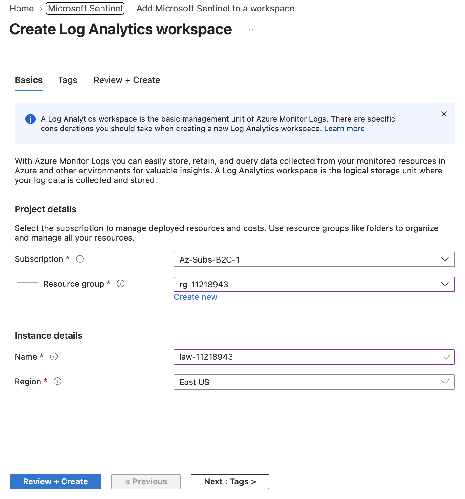
   
  <em>LAW erstellen</em>

### LAW zu Sentinel hinzufügen
Den gerade erstellen LAW auswählen und auf "Add" klicken. Anschliessend wird unter "General" > "Overview" die aktuellen Events, Alerts und Incidents angezeigt (auf meinem Screenshot wird nichts angezeigt, weil der LAW gerade erst erstellt wurde).

  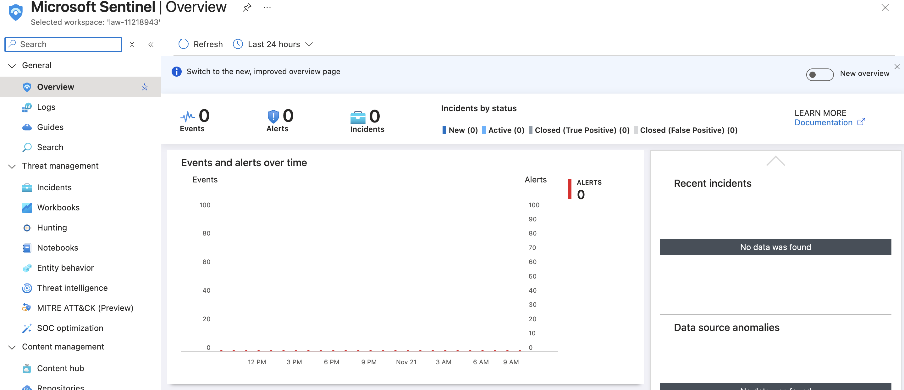
   
  <em>LAW zu Sentinel hinzufügen</em>

Damit wurde die Grundlage für den Einsatz von Microsoft Sentinel geschaffen. Durch die Verknüpfung des Log Analytics Workspace mit Sentinel können zukünftig Sicherheitsdaten zentral gesammelt, analysiert und überwacht werden. Im nächsten Schritt müssen entsprechende Datenquellen (Dataconnectors) angebunden werden, damit Sentinel sicherheitsrelevante Ereignisse erfassen und mögliche Bedrohungen erkennen kann.

## Ingest Data
Data Connectors dienen dazu, verschiedene Datenquellen wie Microsoft Defender, Firewalls oder Cloud-Dienste mit Microsoft Sentinel zu verbinden und deren Logdaten zu sammeln. Über den Content Hub können passende Data Connectors und weitere Sicherheitslösungen installiert werden, damit Sentinel die gesammelten Daten analysieren und mögliche Bedrohungen erkennen kann.

### Content Hub Lösungen installieren
Im Content Hub von Sentinel können verschiedene Sicherheitslösungen und Data Connectors installiert werden. In diesem Lab wird "Microsoft Entra ID" ausgewählt. Damit wir die Anbindung zu Entra ID ermöglicht und damit zu Identitäts- und Anmeldeprotokollen. Damit können beispielsweise Anmeldeaktivitäten überwacht und verdächtige Anmeldeversuche erkannt werden. 

  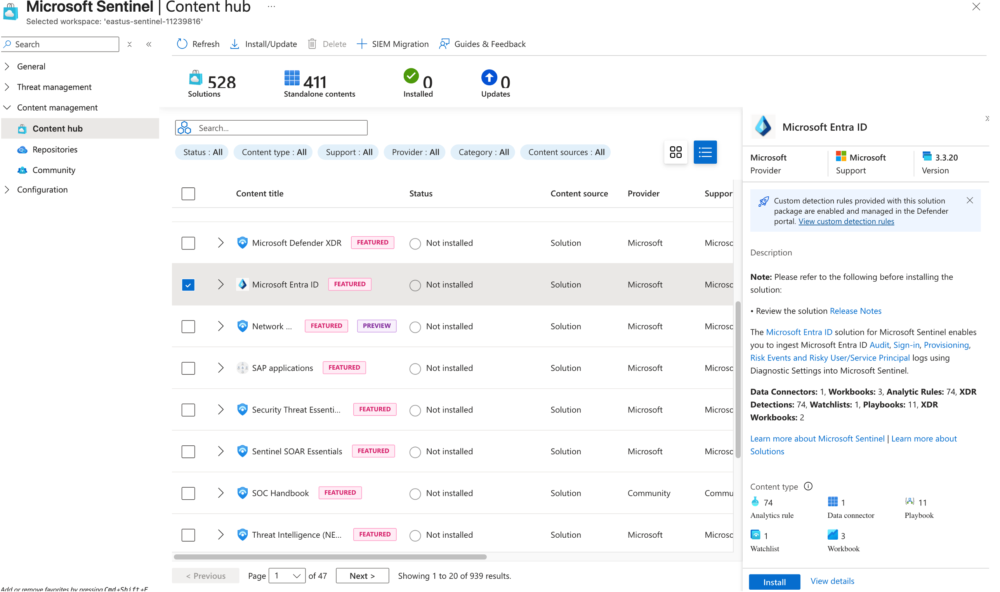
   
  <em>Connectors Hub</em>

Damit wurden insgesamt 89 Komponenten installiert, darunter 1 Data Connector, 74 Analytics Rules, 11 Playbooks und 3 Workbooks. Diese ermöglichen es, Security-Logs zu sammeln, verdächtige Aktivitäten automatisch zu erkennen, Sicherheitsvorfälle zu visualisieren und bestimmte Reaktionen zu automatisieren (hilfreich z.B. für Incident Response). Auf dem Screenshot ist auch zu sehen, dass 86 Komponenten zuerst noch konfiguriert werden müssen.

  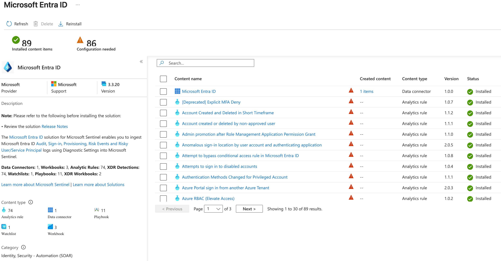
   
  <em>Connectors Hub</em>

### Data Connectors verbinden und konfigurieren
Über den Content Hub wurde die Lösung  Threat Intelligence installiert und anschliessend der Data Connector Microsoft Threat Intelligence geöffnet. Dieser Connector importiert sogenannte Indicators of Compromise (IOCs) aus Microsoft Defender Threat Intelligence in Microsoft Sentinel. Dazu gehören beispielsweise verdächtige IP-Adressen, Domains, URLs oder Datei-Hashes, die auf mögliche Cyberangriffe hinweisen können. Damit können beispielsweise IPs, welche in den Logs auftreten, automatisch geprüft werden, ob diese bekanntlich schädlich sein können bzw. in Verbindung zu verdächtigen Aktivitäten stehen. Der Connector wurde über Connect aktiviert, um diese Bedrohungsindikatoren in Microsoft Sentinel verfügbar zu machen.

  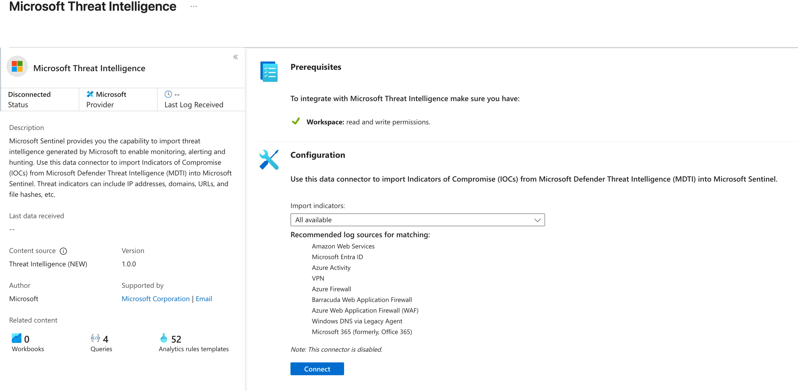
   
  <em>Microsoft Threat Intelligence</em>

Nach der Aktivierung wurde der Status des Data Connectors überprüft. Dieser zeigt Connected an, womit die Verbindung erfolgreich hergestellt wurde. Ausserdem wurden bereits 4 Threat Intelligence Indicators empfangen und im Log Analytics Workspace gespeichert. Dies bestätigt, dass die Datenübertragung funktioniert.

  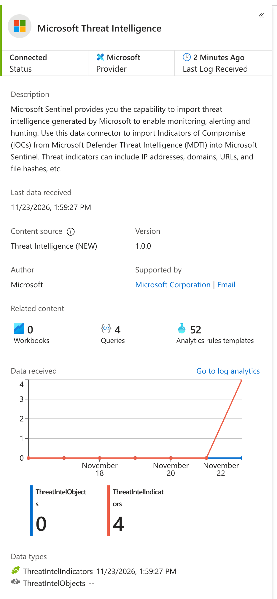
   
  <em>Microsoft Threat Intelligence</em>

## Detect
Nachdem die Datenquellen angebunden wurden und Logdaten in Microsoft Sentinel gesammelt werden, können diese zur Threat Detection genutzt werden. Da eine manuelle Analyse grosser Logmengen kaum möglich ist, verwendet Sentinel sogenannte Analytics Rules, welche die Daten automatisch auf verdächtige Aktivitäten und bekannte Angriffsmuster überprüfen. Werden bestimmte Bedingungen erfüllt, erzeugt Sentinel Alerts, aus denen Incidents erstellt werden können. Diese können anschliessend von SOC-Analysten untersucht und bearbeitet werden. Für die Erstellung solcher Regeln stellt Microsoft bereits vordefinierte Rule Templates zur Verfügung, die an die eigene Umgebung angepasst und aktiviert werden können.

### Analytics Rules aktivieren
Unter Configuration → Analytics → Rule templates stehen verschiedene vordefinierte Erkennungsregeln zur Verfügung (der jeweilige Connector muss im Content Hub zuerst noch installiert werden). Diese können anhand ihrer Schweregrade, Datenquellen und MITRE-ATT&CK-Techniken ausgewählt und für die eigene Umgebung aktiviert werden.

  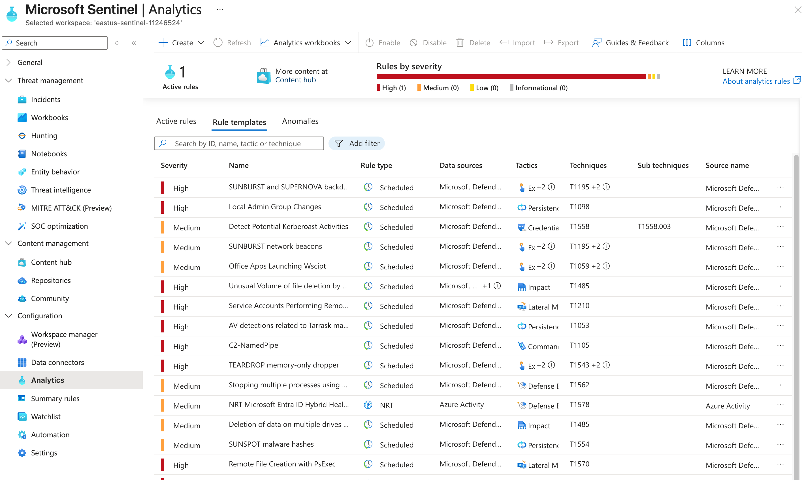
   
  <em>Rule Templates</em>

Für dieses Lab wurde die Vorlage Local Admin Group Changes ausgewählt, welche Änderungen an der lokalen Administratorengruppe erkennt. Die Regel hat den Schweregrad High und ist der MITRE-ATT&CK-Technik T1098 – Account Manipulation zugeordnet.

  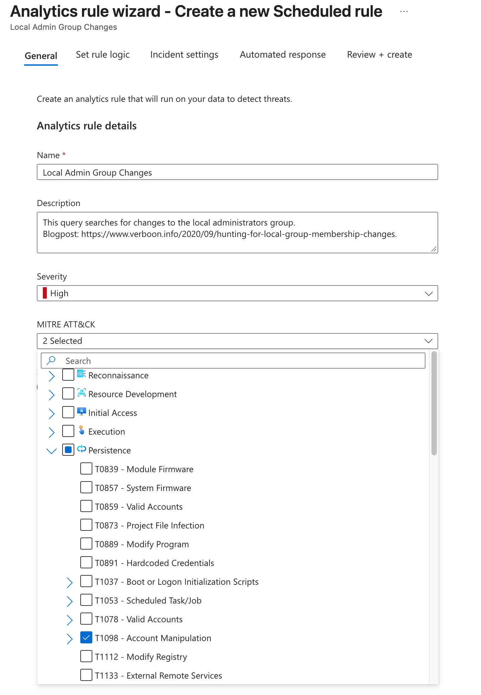
   
  <em>Create Rule from Template</em>

Unter Set rule logic wird die Erkennungslogik mithilfe einer KQL-Abfrage definiert. Die Regel wurde so konfiguriert, dass sie jede Stunde die Logs der letzten Stunde überprüft und einen Alert erzeugt, sobald mindestens ein passendes Ereignis gefunden wird.

  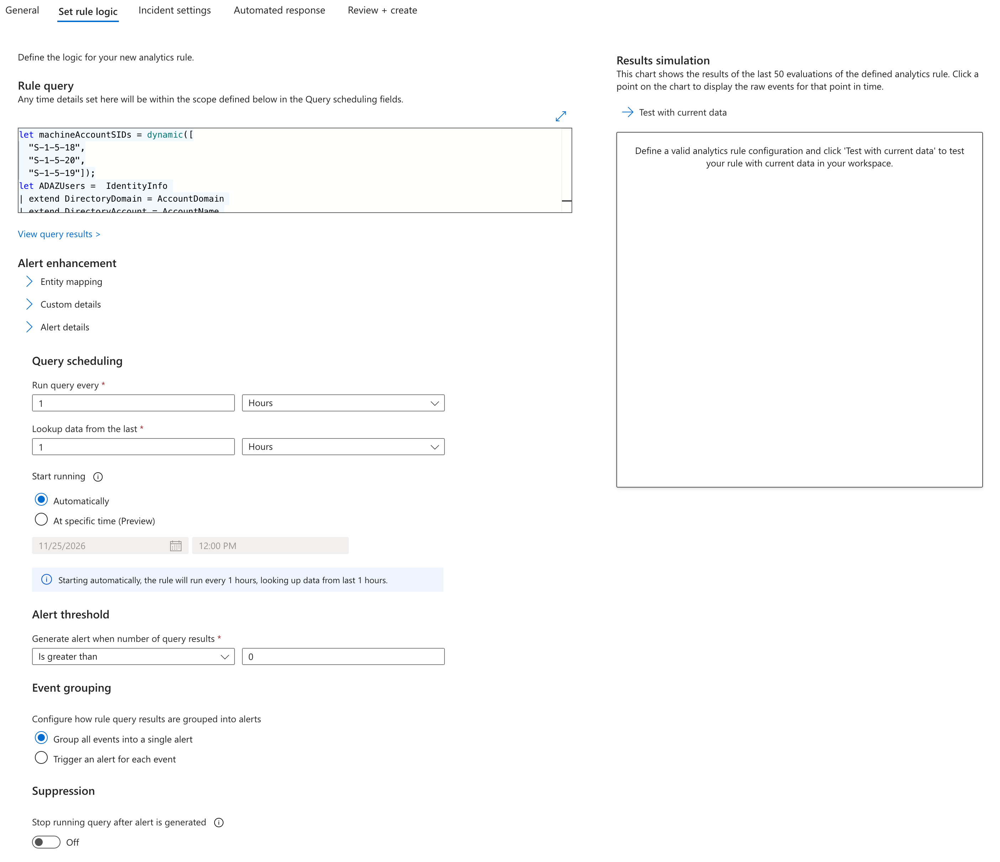
   
  <em>Set Rule Logic</em>

Unter Automated response können Automatisierungsregeln erstellt werden, um bei erkannten Sicherheitsvorfällen automatisch bestimmte Aktionen auszuführen, beispielsweise Playbooks starten oder Incidents zuweisen. In diesem Lab wurde hier noch keine Automatisierung konfiguriert.

  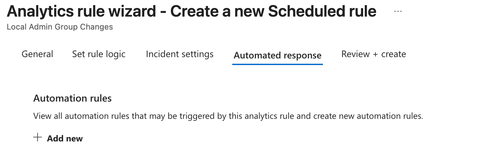
   
  <em>Autoamted Response</em>

Nach der Erstellung erscheint die Regel Local Admin Group Changes unter Active rules mit dem Status Enabled. Insgesamt sind zwei aktive Analytics Rules vorhanden, die beide mit dem Schweregrad High eingestuft sind.

  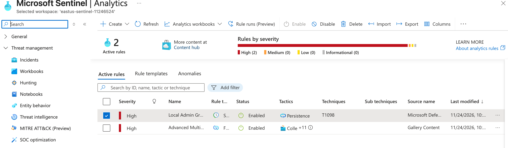
   
  <em>Active Rules</em>

In den Regeleinstellungen lässt sich überprüfen, ob die Analytics Rule korrekt aktiviert und konfiguriert wurde. Die Regel Local Admin Group Changes wird jede Stunde ausgeführt, analysiert die Logs der letzten Stunde und erzeugt einen Alert, sobald die KQL-Abfrage mehr als null Ergebnisse liefert. Die Regel kann über Edit jederzeit angepasst und verfeinert werden. 

  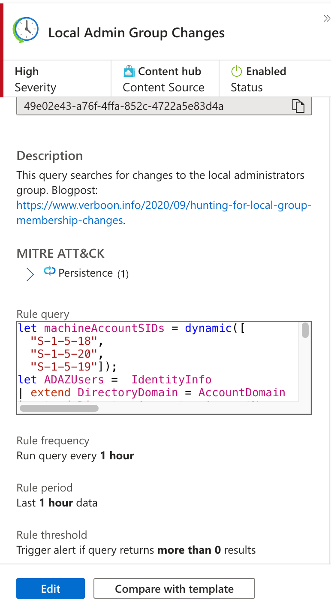
   
  <em>Active Rules Detials</em>

## Investigate

## Fazit
